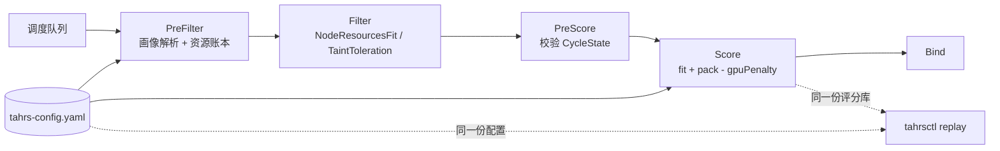

# tahrs-scheduler

异构节点上的放置调度：同时看「装得下」（fit）和「装得紧凑」（pack），用配置里的画像切换两者的配比，
并用离线 `tahrsctl replay` 把一次放置决策逐节点解释出来。

计划文件：`../tahrs-scheduler-dev-plan.md`。

## 状态

| 阶段 | 内容 | 状态 |
|---|---|---|
| T1 | 评分库（model/scoring，无 k8s 依赖） | ✅ 2026-10-28 |
| T2 | 上游账本适配（kubeadapter）+ 4 组对照单测 | ✅ 2026-10-28 |
| T3 | 调度插件 + 框架级验收 + 端到端冒烟 | ✅ 2026-10-28 |
| T4 | 配置与画像测试 | ✅ 2026-10-28 |
| T5 | KWOK 小规模观察（可选） | 未做 |
| T6 | manifest / 镜像 / RBAC 生成 | ✅ 2026-10-28（集群内单副本冒烟待 root 后补，见 `deploy/README.md`） |
| T7 | 文档 | ✅ 本文与 `docs/architecture.md` |

## 架构



模块边界（`internal/model`、`internal/scoring` 不含任何 `k8s.io/*` 依赖，可在没有集群的情况下单测与回放）：

| 包 | 职责 | 允许的依赖 |
|---|---|---|
| `internal/model` | 资源向量、尺度、画像、评分分解 | 仅标准库 |
| `internal/scoring` | `Fit` / `Pack` / `Evaluate`（纯函数，无 I/O） | `model` |
| `internal/kubeadapter` | 把 `fwk.NodeInfo` 与 Pod 请求翻译成 `model` 类型 | `k8s.io/*` |
| `internal/config` | 加载、校验、编译画像、指纹 | `sigs.k8s.io/yaml` |
| `internal/profile` | 注记 → 画像解析 | `config`、`model` |
| `internal/plugin/tahrs` | Framework 插件（PreFilter/PreScore/Score） | 以上全部 + kube-scheduler 框架 |
| `internal/replay` | 离线回放与表格输出 | `config`、`scoring` |
| `internal/observability` | 指标（profile 解析、评分耗时、异常节点） | component-base metrics |

## 快速开始

```bash
make build          # ./tahrs-scheduler 与 ./tahrsctl
make test           # go test -race ./...
make lint           # gofmt -l 检查
```

### 离线解释一次决策

`docs/examples/` 里有三份可直接跑的文件：配置、一个 GPU 工作负载、一个三节点快照。

```bash
./tahrsctl replay \
  --config docs/examples/tahrs-config.yaml \
  --pod   docs/examples/workload.yaml \
  --nodes docs/examples/cluster.yaml
```

真实输出（2026-10-28，配置指纹可复现）：

```
profile=gpu-inference-v1 configHash=23f8b903
NODE        FIT     PACK    PENALTY  SCORE  NOTE
gpu-node-1  0.4194  0.5581  0        52
gpu-node-2  0.3023  0.4697  0        42
cpu-node-1  0.0000  0.0000  0        0      error: node allocatable is zero for a requested dimension: node "cpu-node-1" dimension "gpu" requested=1 allocatable=0
```

读法：`fit` 是「请求形状与剩余形状的相似度」，`pack` 是「节点已用比例」，`score = round(100 × (α·fit + β·pack)) − gpuPenalty`。
CPU 节点对 GPU 请求直接报异常行并给 `MinScore`，调度器里同一情形也是 `MinScore`（见 `docs/architecture.md` 的 R7）。

### 在集群里用

```bash
make image                                     # 或 deploy/README.md 里的 ko 命令（无 Docker 引擎时）
kubectl create namespace tahrs-system
kubectl apply -k deploy/base
```

工作负载接入示例：`deploy/common/examples/gpu-demo.yaml`（`schedulerName`、画像注记、容忍 GPU 池污点、`limits` 声明 GPU）。

## 配置

格式见 `docs/examples/tahrs-config.yaml`，校验规则见 `internal/config/validation.go`（八条，启动时聚合报错）。
配置改动需要重启调度器（没有热加载），启动日志会打印一行配置指纹：

```
configVersion=2026-10-tahrs1 configHash=23f8b903 build=dev defaultProfile=cpu-general-v1 ...
```

注记键：`scheduling.example.com/profile`；未知画像会在 **PreFilter** 阶段以 `UnschedulableAndUnresolvable` 拒绝，
理由里带本次配置指纹，方便对照「是不是配置没生效」。

## 已知局限

- 单可行节点时框架不调用 Score（上游 `schedule_one.go` 的短路），所以画像校验放在 PreFilter 而不是 Score（F13）。
- 不支持 DRA（`ResourceClaim`）的分配，账本只覆盖 request/limit。
- 没在真实 GPU 机器上验证过「伪 GPU 资源」与真实显存分配的偏差；评测只到 KWOK/伪资源层面（T5 也未做）。
- 镜像体积约 106 MB（解压后；压缩层 48.6 MB），主要来自 k8s 库。

## 文档

- `docs/architecture.md`：设计决策与「为什么」，含上游源码位置与实测数字。
- `deploy/README.md`：部署清单、RBAC 来源与偏离、镜像与冒烟记录。
- `AGENTS.md`：本仓库的编码/测试/提交约定。
